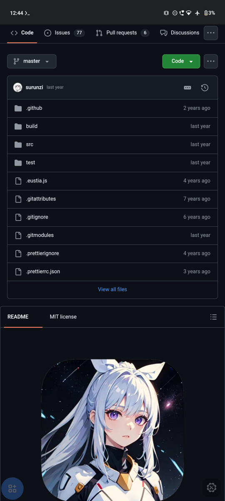
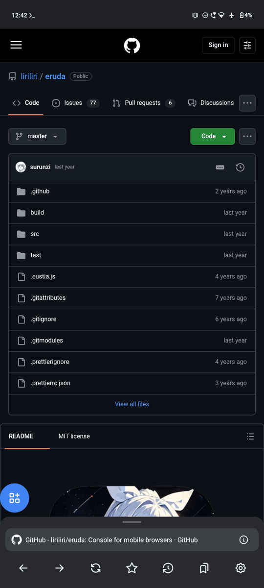
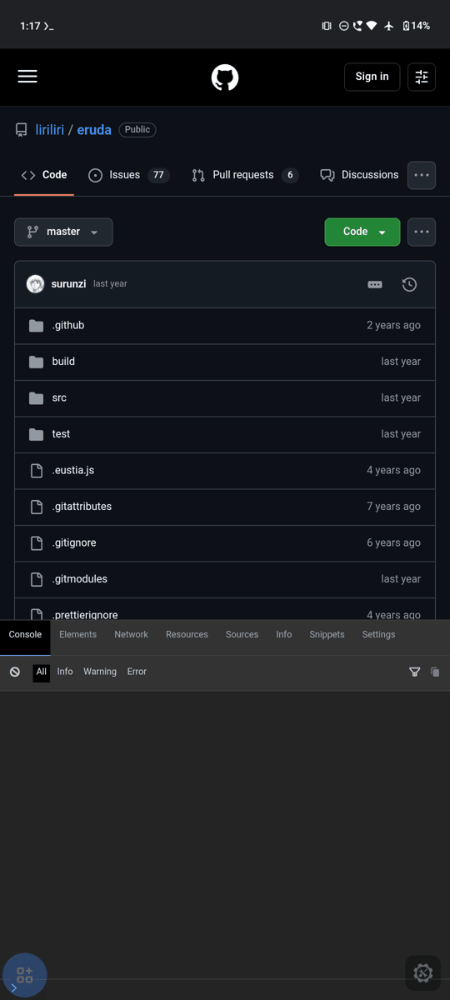
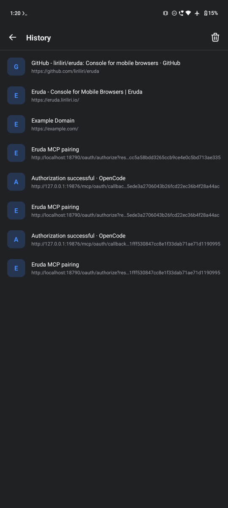
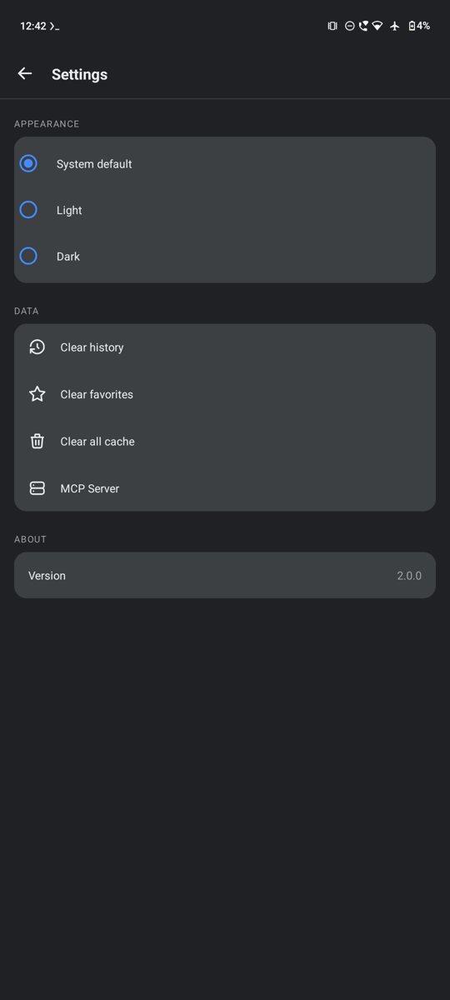
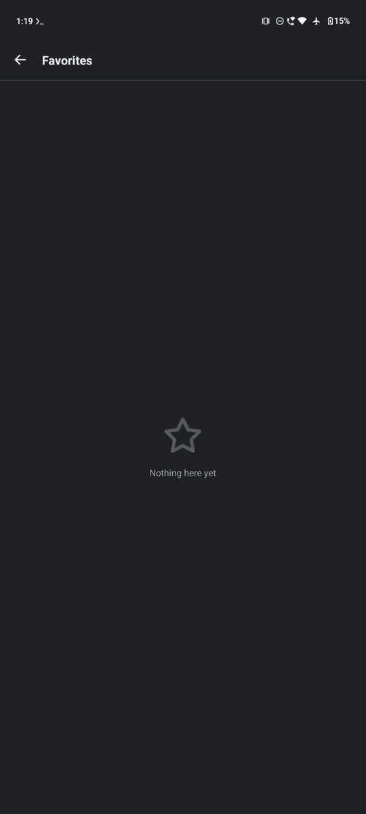
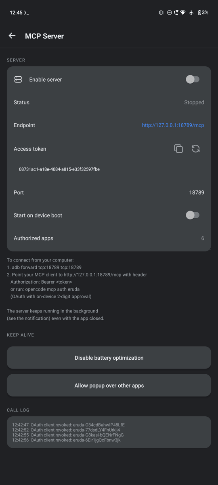
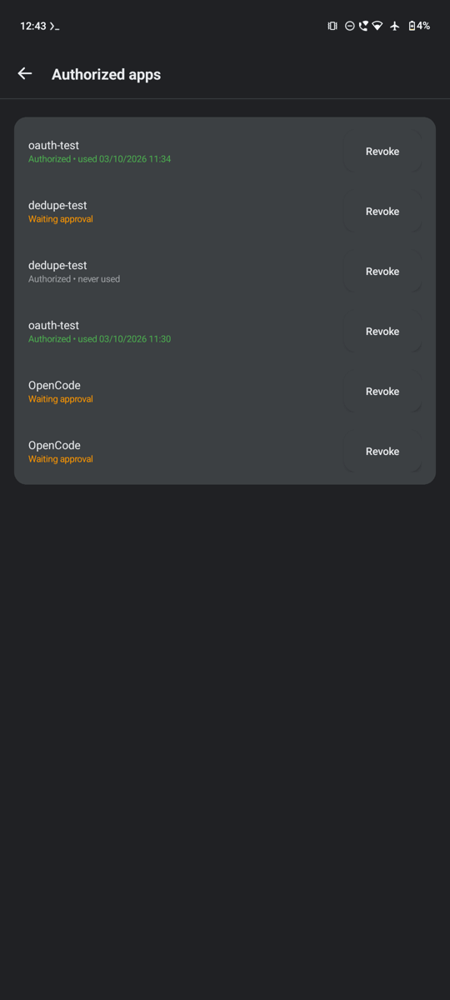

# eruda-android

A full-screen WebView browser that loads [eruda](https://github.com/liriliri/eruda) automatically on every page — now with an **on-device MCP server** so AI agents can drive the browser for mobile web testing.

Forked from [liriliri/eruda-android](https://github.com/liriliri/eruda-android). Current version: **2.0.0**.

| Browser | Browser + dock |
|---|---|
|  |  |

| Eruda console | History |
|---|---|
|  |  |

| Settings | Favorites |
|---|---|
|  |  |

| MCP Server | Authorized apps |
|---|---|
|  |  |

## Browser features

- Eruda console auto-injected on every page (offline, served from assets)
- Floating action button + bottom dock (back, forward, refresh, bookmark, history, favorites, settings)
- History & Favorites with search, Site Info panel (ⓘ), clear cache / site data
- System / Light / Dark theme, rotation-safe (no page reload, FAB follows orientation)

## MCP server

Exposes the in-app WebView over Streamable HTTP (`POST /mcp`, JSON-RPC 2.0) with **24 tools**:

| Tool | What it does |
|---|---|
| `eruda_screenshot` | Page as PNG (MCP image block) |
| `eruda_tap` / `eruda_click` / `eruda_dblclick` | Tap, click and double-click at screenshot pixels |
| `eruda_press` | Long-press at coordinates |
| `eruda_swipe` / `eruda_scroll` / `eruda_pinch` | Gestures, incl. two-finger zoom |
| `eruda_type` / `eruda_fill` | Type into the focused field / set any field by selector (native value setter, so React/Vue controlled inputs update) |
| `eruda_click_selector` / `eruda_hover` | Click or hover an element by CSS selector |
| `eruda_press_key` | Real key events: Enter, Tab, Escape, Backspace, arrows, PageUp/Down, or a single character |
| `eruda_wait_for` | Poll until an element exists (and is visible) |
| `eruda_dom_query` | Tag, text and rects of matches — `rectDevice` is in screenshot pixels |
| `eruda_eval_js` | Evaluate JavaScript, return the value |
| `eruda_navigate` / `eruda_back` / `eruda_forward` / `eruda_reload` | Navigation |
| `eruda_page_info` | URL, title, HTTPS status |
| `eruda_console_logs` / `eruda_network_requests` | Recent console messages / requests |
| `eruda_clear_site_data` | Clear cache, cookies, storage + reload |

### Authentication

Dual-accept, configured in **Settings → MCP Server**:

1. **Static bearer token** (copy / regenerate in the app).
2. **Self-contained OAuth 2.1** — Dynamic Client Registration + PKCE S256 + a **2-digit code** checked against **one** approval popup. The popup is picked automatically: in-app dialog when the app is in front, system overlay when it is behind (needs the overlay permission), heads-up notification with Approve/Deny as the last resort. Approving on the phone delivers the code to the client directly; if the client's callback is unreachable (client on a computer), the request stays pending and you approve in the browser window the client opened. Manage clients under *Authorized apps* (revoke anytime).

### Keeping it running

- Foreground service + WakeLock + persistent notification (with Stop action), so the server keeps working with the screen off or the app swiped away.
- **Headless WebView**: when the UI is gone but the service is alive, tools switch to an invisible WebView (attached to a transparent, non-touchable system overlay; needs the overlay permission) and keep working — same last page, same tools. It is dropped as soon as the app is reopened.
- Optional **Start on device boot** toggle.
- Battery-optimization and overlay-permission shortcuts built into the MCP screen.
- Debug log at every request stage: `cache/mcp-debug.log` (readable via `run-as`), including which browser the tools targeted.

### Connecting (opencode)

```bash
adb forward tcp:18790 tcp:18789   # host port can differ
```

Bearer (static) — `opencode.json`:

```json
{
  "mcp": {
    "eruda": {
      "type": "remote",
      "url": "http://localhost:18790/mcp",
      "headers": { "Authorization": "Bearer <token>" },
      "oauth": false
    }
  }
}
```

OAuth (2-digit approval) — with the forward active:

```bash
opencode mcp auth eruda
```

One popup appears on the phone; tap **Approve** if the code matches. On a computer the client's callback is unreachable, so finish in the browser window it opened. If your client runs on the phone itself (Termux/chroot), the app's popup completes everything by itself — no browser needed, as long as the auth process stays alive until you approve.

### Why "Waiting approval" appears before any popup

A client is listed in *Authorized apps* as soon as it registers (Dynamic Client Registration), which happens **before** the authorization request exists. The popup is only triggered when the client opens `/oauth/authorize`. A CLI that cannot launch a browser (e.g. inside Termux/chroot) just prints the URL and waits, so the phone stays silent until that URL is opened — either by a browser or by the client itself.

If the client process dies before the approval (Android reclaiming memory, terminal closed, `opencode` restarted), its loopback callback port disappears. The app then logs `callback unreachable`, keeps the request pending and shows the popup again; approving in the browser has nowhere to deliver the code. The debug log tells the stages apart:

- `OAuth client registered` — registration only; no popup yet.
- `GET /oauth/authorize` — the request arrived; this is what triggers the popup.
- `OAuth callback delivery failed` — the client's callback port is closed; keep the process alive and retry.

Clients that never finish authorization stay in *Authorized apps* as *Waiting approval* (they do not expire); revoke them there. Re-running the auth command creates a fresh registration.

### Testing the auth flow

Two scripts in `tools/` reproduce what a client does, without opencode:

```bash
python3 tools/mcp_oauth_test.py --approve manual   # shows one popup; approve on the phone
python3 tools/mcp_oauth_test.py --approve auto     # fully automated (DCR, PKCE, callback, token, refresh)

# exercises every WebView tool against a built-in page (served on a random local port)
ERUDA_MCP_TOKEN=<static token> python3 tools/mcp_tools_test.py
```

## Permissions

`INTERNET` · `WAKE_LOCK` · `FOREGROUND_SERVICE(_SPECIAL_USE)` · `POST_NOTIFICATIONS` · `REQUEST_IGNORE_BATTERY_OPTIMIZATIONS` · `SYSTEM_ALERT_WINDOW` (optional popup) · `RECEIVE_BOOT_COMPLETED` (optional auto-start).

## Build

```bash
sh ./gradlew :app:assembleDebug --console=plain
adb install -r app/build/outputs/apk/debug/eruda-v2.0.0-debug.apk
```

Requires Android SDK (compile/target 34, min 21), JDK 17+. See [CHANGELOG.md](CHANGELOG.md) for version history.

## Credits

- Original browser by [liriliri](https://github.com/liriliri) ([eruda-android](https://github.com/liriliri/eruda-android)).
- This fork is maintained by [isakii-dev](https://github.com/isakii-dev), developed on-device (Android phone) with [opencode](https://opencode.ai) using several different AI models across sessions — not a single one.
